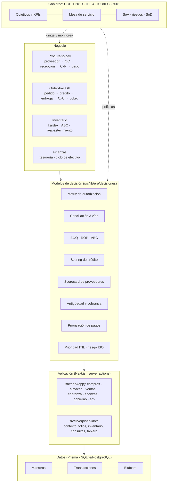
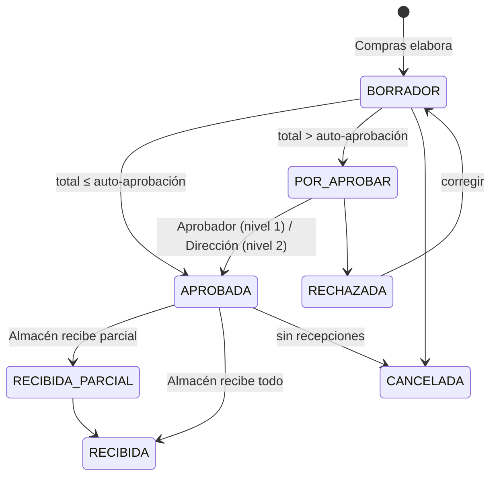
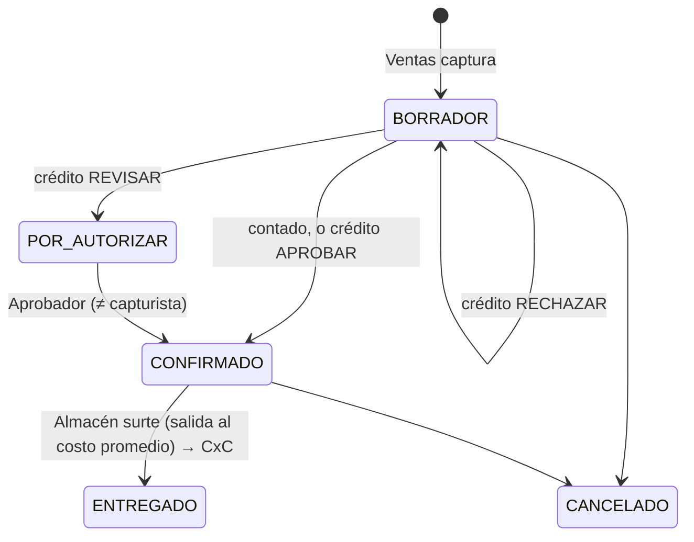

# Arquitectura empresarial · ERP centralizado

Sistema centralizado de **compras** (proveedores, órdenes de compra, recepción), **almacén**,
**ventas**, **cobranza** y **finanzas**, con **modelos de decisión** explícitos y gobernado con
**COBIT 2019**, **ITIL 4** e **ISO/IEC 27001:2022**. Convive con el módulo de permisos
COFEPRIS/VUCEM 260211 en la misma aplicación, con la misma empresa (multi-RFC), usuarios,
roles y bitácora.

## 1. Principios de arquitectura

| Principio | Cómo se cumple |
| --- | --- |
| **Una sola fuente de verdad** | Datos maestros únicos por empresa (artículos, almacenes, proveedores, clientes). Todos los módulos leen y escriben la misma base. |
| **Decisiones explícitas y auditables** | Cada decisión automática es una función pura en `src/lib/erp/decisiones/` con pruebas; su resultado queda en el documento (p. ej. `PedidoVenta.evaluacionCredito`) y en la bitácora. |
| **Gestión por excepción** | Los modelos deciden lo rutinario (OC dentro de política, crédito sano, conciliación correcta) y escalan a una persona solo las excepciones (tablero ejecutivo → «Decisiones pendientes»). |
| **Control interno por diseño** | Matriz de autorización, conciliación a tres vías, segregación de funciones y kárdex inmutable implementados en las server actions, no en la interfaz. |
| **Políticas parametrizables** | Umbrales, tolerancias, puntajes y nivel de servicio en `ConfiguracionErp` (Gobierno → Políticas), con bitácora del valor anterior y nuevo. |
| **Aislamiento por empresa** | Toda consulta filtra por `empresaId` de la sesión; los ids que llegan del navegador se validan contra la empresa activa. |

## 2. Capas

| Capa | Ubicación |
| --- | --- |
| Presentación | `src/app/(app)/{erp,compras,almacen,ventas,cobranza,finanzas,gobierno}`, componentes en `src/components/erp` |
| Aplicación (casos de uso) | Server actions `acciones.ts` de cada módulo |
| Dominio / decisión | `src/lib/erp/decisiones/*.ts` (puras), `src/lib/erp/permisos.ts`, `src/lib/erp/dinero.ts` |
| Servicios | `src/lib/erp/servidor/` (contexto ERP, folios, kárdex con costo promedio, consultas analíticas, tablero) |
| Datos | `prisma/schema.prisma` (sección ERP) y migración `20261014090000_erp_arquitectura_empresarial` |

## 3. Procesos de negocio

### 3.1 Procure-to-pay

Cada recepción: (1) entradas al kárdex al costo pactado en la OC y nuevo **costo promedio
ponderado**; (2) **conciliación a tres vías** OC–recepción–factura; (3) alta de la **cuenta por
pagar**: `PENDIENTE` si concilia, `BLOQUEADA` si no. Una CxP bloqueada se libera registrando la
factura correcta o por **excepción** de un aprobador con justificación. El pago genera un egreso
en tesorería.

### 3.2 Order-to-cash

La entrega crea la **cuenta por cobrar** (contado vence el mismo día; crédito según los días del
cliente). Cobranza registra cobros (ingreso en tesorería) y gestiones; la gestión «Suspensión de
crédito» suspende al cliente y el modelo de crédito rechaza nuevos pedidos a crédito.

## 4. Modelos de decisión

| Modelo | Archivo | Regla | Parámetros (Políticas) |
| --- | --- | --- | --- |
| Matriz de autorización de OC | `decisiones/compras.ts` | nivel 0 si total ≤ A; nivel 1 (Aprobador o admin) si ≤ B; nivel 2 (admin) arriba | A = `montoAutoAprobacion` ($5,000), B = `montoAprobacionNivel1` ($50,000) |
| Conciliación a tres vías | `decisiones/compras.ts` | esperado = Σ recibido × costo OC + IVA; \|factura − esperado\| ≤ tolerancia → OK; recibido acumulado > ordenado × (1+tol) → rechazo | `toleranciaPrecioBp` (2 %), `toleranciaCantidadBp` (0 %) |
| Scorecard de proveedores | `decisiones/compras.ts` | 35 % calidad + 30 % puntualidad + 20 % cumplimiento + 15 % facturación correcta → A ≥ 85, B ≥ 70, C ≥ 50, D | — |
| Lote económico (EOQ) | `decisiones/inventario.ts` | √(2·D·S / H), H = costo × % de mantener | por artículo: D, S, % mantener |
| Stock de seguridad y ROP | `decisiones/inventario.ts` | SS = z·σ·√L; ROP = d·L + SS (≥ mínimo); pedir si existencia + tránsito ≤ ROP | `factorServicioZ` (1.65 ≈ 95 %) |
| Clasificación ABC | `decisiones/inventario.ts` | Pareto por valor de consumo anual: A hasta 80 %, B hasta 95 %, C | — |
| Crédito | `decisiones/credito.ts` | 100 − uso de línea (−15/−40) − atraso promedio (≤ 30) − % vencido × 40 − vencido > gracia (−25) − sin historial (−10) → APROBAR / REVISAR / RECHAZAR; suspendido o sin línea = RECHAZAR | `puntajeCreditoMinimo` (60), `puntajeCreditoRevision` (40), `diasGraciaCredito` (15) |
| Cobranza por tramo | `decisiones/cobranza.ts` | por vencer, 1-30, 31-60, 61-90, > 90 días → estrategia y provisión 0/3/15/40/80 % | — |
| Priorización de pagos | `decisiones/finanzas.ts` | atraso (≤ 50) + cercanía (≤ 30) + criticidad (20/10); asignación voraz del efectivo | efectivo disponible (simulable) |
| Indicadores financieros | `decisiones/finanzas.ts` | DSO, DIO, DPO, CCC = DSO + DIO − DPO, margen bruto, rotación | periodo 90 días |
| Prioridad ITIL | `decisiones/itil.ts` | prioridad = impacto + urgencia − 1 (P1…P5) → SLA 4/8/24/72/168 h | — |
| Riesgo ISO 27001 | `decisiones/riesgos.ts` | valor = p × i (5×5); bajo ≤ 4, medio ≤ 9, alto ≤ 16, crítico; aceptar > 9 solo admin | apetito = 9 |
| Brecha COBIT | `decisiones/gobierno.ts` | brecha = objetivo − actual; hoja de ruta por mayor brecha; semáforo vs. meta (±10 %) | nivel objetivo por control |

## 5. Gobierno

### 5.1 COBIT 2019

Objetivos cargados por empresa (Gobierno → COBIT) con autoevaluación de capacidad 0-5:
EDM03, APO01, APO06, APO10, APO12, APO13, BAI06, BAI09, DSS01, DSS02, DSS03, DSS05, DSS06,
MEA01, MEA02, MEA03. El tablero ejecutivo (`/erp`) implementa **MEA01**: KPIs con meta y
semáforo.

| KPI | Meta | Objetivo |
| --- | --- | --- |
| Margen bruto | ≥ 25 % | APO06 |
| Ciclo de conversión de efectivo | ≤ 60 días | APO06 |
| Calidad de proveedores (sin rechazos) | ≥ 98 % | APO10 |
| Entregas a tiempo | ≥ 90 % | APO10 |
| Facturas conciliadas sin diferencia | ≥ 95 % | DSS06 |
| Cartera vencida | ≤ 15 % | APO12 |
| Cumplimiento de SLA | ≥ 90 % | DSS02 |
| Madurez COBIT promedio | ≥ 3 | MEA01 |
| Controles ISO en nivel objetivo | ≥ 80 % | APO13 |

### 5.2 ITIL 4

Mesa de servicio (`/gobierno/servicios`) para los servicios de negocio (Compras, Almacén, Ventas,
Cobranza, Finanzas, TI): **gestión de incidentes**, **problemas**, **solicitudes de servicio** y
**habilitación de cambios** (estándar preaprobado; normal y emergencia requieren CAB = Aprobador
o administrador, distinto de quien lo solicita). Resolver exige documentar la solución.

### 5.3 ISO/IEC 27001:2022

- **Declaración de aplicabilidad** (`/gobierno/controles?marco=ISO27001`): A.5.1, A.5.2, A.5.3,
  A.5.9, A.5.15, A.5.18, A.5.19, A.5.24, A.5.26, A.5.34, A.8.2, A.8.5, A.8.13, A.8.15, A.8.24,
  A.8.32, con aplicabilidad, justificación de exclusiones, nivel, responsable y evidencia.
- **Evaluación y tratamiento de riesgos** (cl. 6.1.2 / 6.1.3): registro con matriz 5×5, mapa de
  calor, tratamiento, controles del Anexo A y riesgo residual.
- **Segregación de funciones (A.5.3)**:

| Regla | Dónde se aplica |
| --- | --- |
| Quien elabora una OC no la aprueba | `aprobarOC` |
| Quien aprueba una OC no registra su recepción | `registrarRecepcion` |
| Quien registra la recepción no paga la factura | `pagarCxP` |
| Quien captura un pedido a crédito no autoriza la excepción | `autorizarCredito` |
| Quien solicita un cambio no lo aprueba (CAB) | `cambiarEstadoTicket` |

  Con «segregación estricta» se bloquea; sin ella se permite y queda como excepción en la bitácora.
- **Control de acceso (A.5.15 / A.8.2)**: rol (Administrador, Capturista, Solo consulta) + **áreas
  funcionales** por usuario (`Membresia.areas`): Compras, Almacén, Ventas, Cobranza, Finanzas,
  Aprobador, Gobierno. Operaciones privilegiadas (políticas, castigo de cartera, aceptar riesgos
  altos) solo administradores.
- **Registro de eventos (A.8.15)**: cada alta, cambio, aprobación, recepción, pago, cobro,
  liberación y cambio de política queda en `Bitacora` con usuario, fecha y detalle.

### 5.4 Matriz RACI

| Proceso | Compras | Almacén | Ventas | Cobranza | Finanzas | Aprobador | Gobierno |
| --- | --- | --- | --- | --- | --- | --- | --- |
| Elaborar OC | R | I | | | I | I | |
| Autorizar OC | C | | | | C | A | |
| Recibir mercancía | I | R | | | I | | |
| Conciliar y pagar | C | | | | R | A | |
| Pedido y crédito | | | R | C | | A | |
| Surtido y entrega | | R | I | I | | | |
| Cobranza | | | C | R | I | | |
| Riesgos, controles y cambios | | | | | C | A | R |

## 6. Modelo de datos (ERP)

| Entidad | Propósito |
| --- | --- |
| `ConfiguracionErp` | Políticas de decisión por empresa |
| `Almacen`, `Articulo`, `Existencia` | Maestros de inventario; existencia y costo promedio por almacén |
| `MovimientoInventario` | Kárdex inmutable (entradas, salidas, ajustes, inventario inicial) |
| `Proveedor`, `OrdenCompra`, `PartidaOrdenCompra` | Compras |
| `Recepcion`, `PartidaRecepcion` | Recepciones con conciliación y puntualidad |
| `CuentaPorPagar`, `PagoProveedor` | Cuentas por pagar |
| `Cliente`, `PedidoVenta`, `PartidaVenta` | Ventas con evaluación de crédito |
| `CuentaPorCobrar`, `Cobro`, `GestionCobranza` | Cobranza |
| `MovimientoTesoreria` | Ingresos y egresos (cobros y pagos automáticos) |
| `ControlGobierno` | Objetivos COBIT y controles ISO 27001 por empresa |
| `RiesgoSeguridad` | Registro de riesgos |
| `TicketServicio` | Incidentes, problemas, solicitudes y cambios |

Convenciones: importes en **centavos** (`Int`), cantidades con hasta 3 decimales, tasas en
**puntos base** (1600 = 16 %), consecutivo por empresa en cada documento.

## 7. Pruebas

- `tests/erp/decisiones.test.ts`: cada modelo de decisión con casos límite.
- `tests/erp/flujos.test.ts`: procure-to-pay, order-to-cash, segregación de funciones, permisos
  por área, aislamiento entre empresas, reabastecimiento y gobierno contra SQLite real.
- `e2e/erp.spec.ts`: recorrido en navegador con los datos de demostración.
